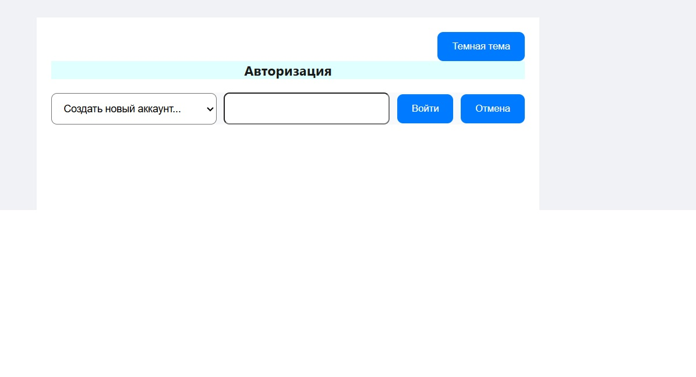
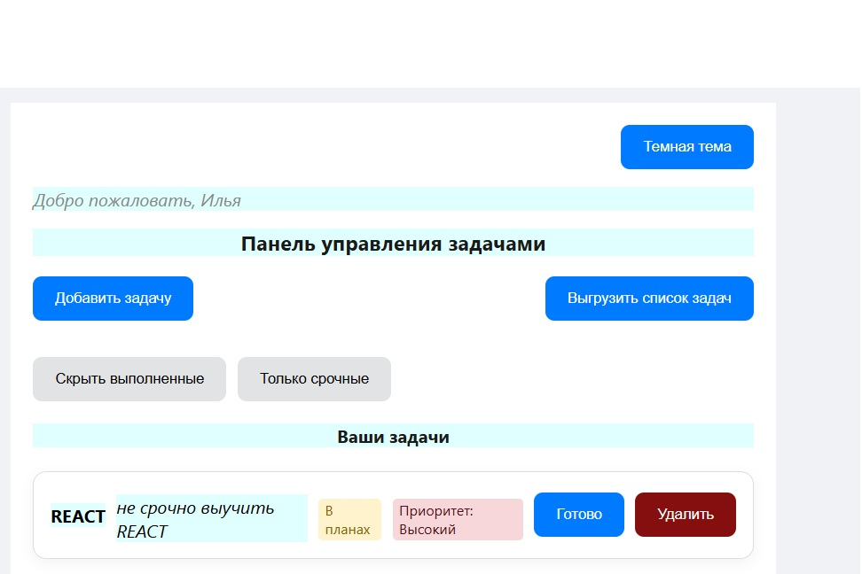
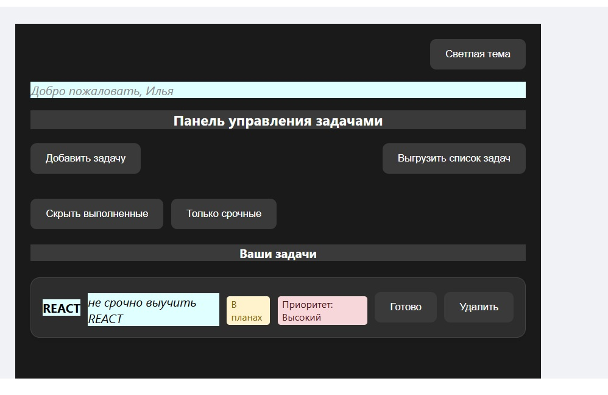

# 📋 React Task Manager (Итоговый проект)

Учебный менеджер задач с авторизацией и JSON-хранилищем.

## Возможности
- Регистрация и вход (bcrypt + JWT)
- CRUD задач (создание, просмотр, обновление, удаление)
- Фильтрация по статусу и автору
- Экспорт в CSV

---

## Стек
**Frontend:** React 19, React Router 7, [ React App ] 
**Backend:** Node.js, чистый `http`, JSON-файлы  
**Безопасность и окружение:** bcryptjs, JWT, dotenv

> ⚠️ Проект учебный: данные в JSON, не для продакшена.

---

## Скриншоты




---

## Запуск

1. Клонируйте:
```bash
git clone https://github.com/ilyaGladyshev/react-itog.git
cd react-itog

Установите зависимости:

```bash
npm install
cd backend
npm install
cd ..
```
Запустите:

Бэкенд (в отдельном терминале):
```bash
cd backend
node server.js
Сервер: http://localhost:5000
Фронтенд:
```
```bash
npm run dev
Приложение: http://localhost:3000
```
---

API

| Метод | Путь | Описание |
| :--- | :--- | :--- |
| POST | `/api/auth/register` | Регистрация пользователя |
| POST | `/api/auth/login` | Вход, возвращает токен/сессию |
| GET | `/api/tasks` | Список задач (с фильтрацией) |
| POST | `/api/tasks` | Создать задачу |
| PUT | `/api/tasks/:id` | Обновить задачу |
| DELETE | `/api/tasks/:id` | Удалить задачу |
| GET | `/api/tasks/export` | Экспорт задач в CSV |

---

Переменные окружения
В backend/.env:
env
JWT_SECRET=твой_секретный_ключ
PORT=5000
---

Автор: Илья Гладышев (ilyaGladyshev)

---

