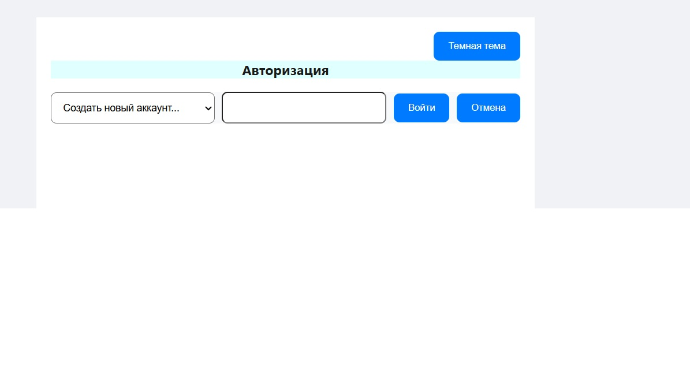
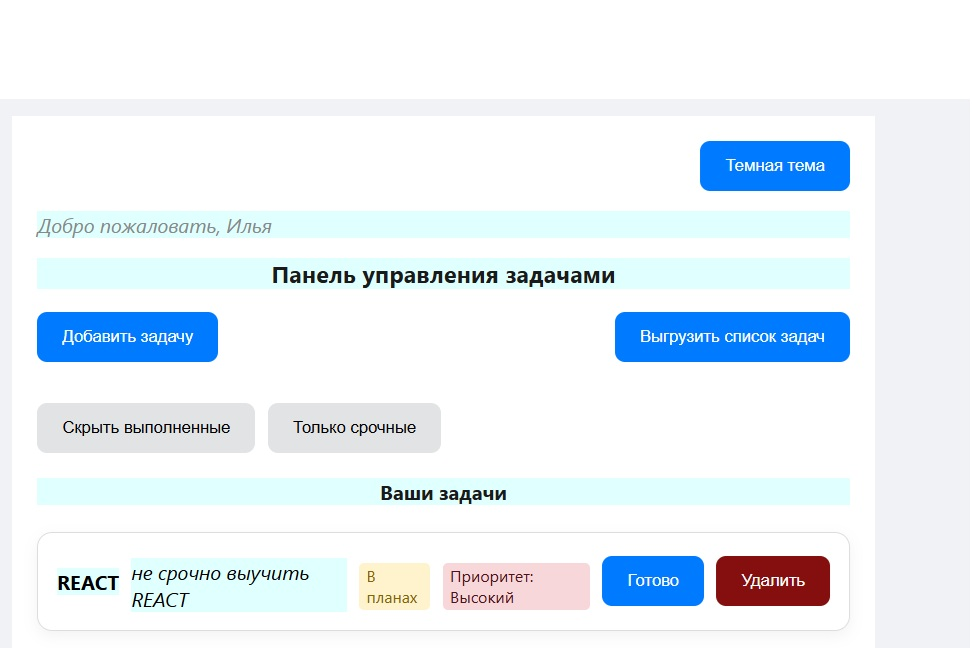
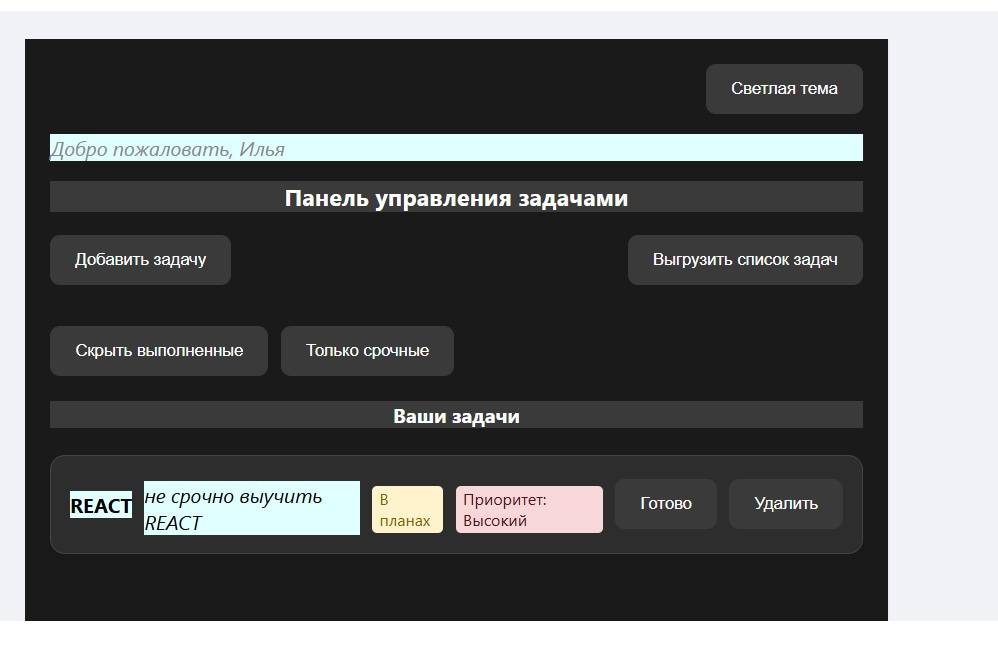

# 📋 React Task Manager (Итоговый проект)

Учебный менеджер задач с авторизацией и хранением данных в MySQL.

## Возможности
- Регистрация и вход (bcrypt + JWT)
- CRUD задач (создание, просмотр, обновление, удаление)
- Фильтрация по статусу и автору
- Экспорт в CSV
- Хранение данных в MySQL.

---

## Стек
**Frontend:** React 19, React Router 7, [ Create React App ] 
**Backend:** Node.js, чистый `http`, MySQL  
**Безопасность и окружение:** bcryptjs, JWT, dotenv

---

## Скриншоты




---

## Запуск

### 1. Клонируйте репозиторий:
```bash
git clone https://github.com/ilyaGladyshev/react-itog.git
cd react-itog
```

### 2. Установите зависимости:

```bash
npm install
cd backend
npm install
cd ..
```

### 3. Настройка базы данных
Создайте базу данных в MySQL:
```sql
CREATE DATABASE task_manager CHARACTER SET utf8mb4 COLLATE utf8mb4_unicode_ci;
USE task_manager;
```
Примените схему (создание таблиц):
```bash
mysql -u root -p task_manager < react-itog/backend/db/schema.sql
```

### 4. Запустите:

Бэкенд (в отдельном терминале):
```bash
cd backend
node server.js
```
Сервер: http://localhost:5000
Фронтенд:
```bash
npm run dev
```
Приложение: http://localhost:3000

---

API

| Метод | Путь | Описание |
| --- | --- | --- |
| POST | `/api/auth/register` | Регистрация пользователя |
| POST | `/api/auth/login` | Вход, возвращает токен/сессию |
| GET | `/api/tasks` | Список задач (с фильтрацией) |
| POST | `/api/tasks` | Создать задачу |
| POST | `/api/tasks/complete` | Завершить задачу |
| POST | `/api/tasks/delete` | Удалить задачу |
| GET | `/api/tasks/export` | Экспорт задач в CSV |

---

Переменные окружения
В backend/.env:
```env
JWT_SECRET=ваш_секретный_ключ_здесь
DB_HOST=localhost
DB_USER=root
DB_PASSWORD=ваш_пароль_от_mysql
DB_NAME=task_manager
```
---

Автор: Илья Гладышев (ilyaGladyshev)

---

